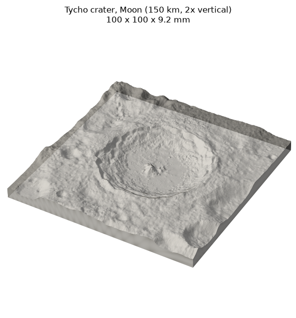
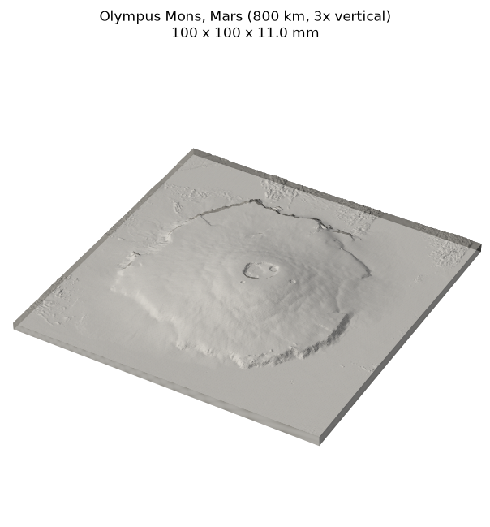
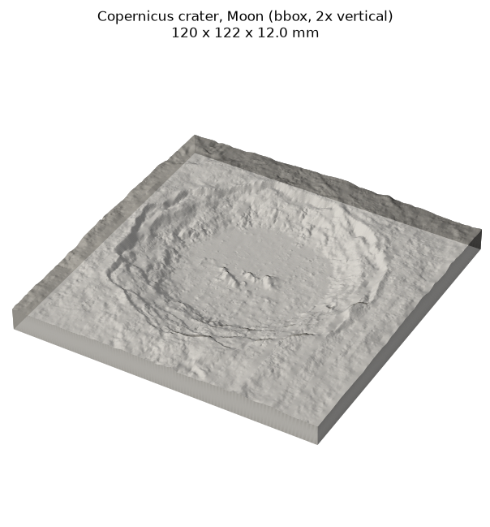

# planetary-dem-to-stl

[](https://github.com/SimplySolid3D/planetary-dem-to-stl/actions/workflows/tests.yml)

Turn real Moon and Mars terrain into a 3D-printable STL with one command.

You pick a world, a spot (centre + size, or a lat/lon box), how wide the print
should be and how much to stretch the heights. The tool reads public NASA
laser-altimeter elevation data (LRO LOLA for the Moon, MGS MOLA for Mars) straight
from the USGS servers and writes a **watertight binary STL**: a solid block with
a flat base, ready for any slicer.

That's all it does, on purpose. Small, readable code; numpy is the only runtime
dependency.

| Tycho crater (Moon) | Olympus Mons (Mars) | Copernicus crater (Moon) |
|---|---|---|
|  |  |  |

## Install

Python 3.10 or newer.

```bash
pip install git+https://github.com/SimplySolid3D/planetary-dem-to-stl
```

or from a clone:

```bash
git clone https://github.com/SimplySolid3D/planetary-dem-to-stl
cd planetary-dem-to-stl
pip install -e .
```

This installs the `planet-stl` command.

## Examples

These are the exact commands behind the previews above. Each one downloads
2-5 MB and takes 10-20 seconds.

**Tycho crater, Moon** - a 150 km square around the crater, 100 mm wide, heights x2:

```bash
planet-stl moon --lat -43.31 --lon -11.36 --size-km 150 --exaggeration 2 -o tycho.stl
# wrote tycho.stl: 100.0 x 100.0 x 9.2 mm, 324,800 triangles, grid 401x401
# ground 150.0 x 150.0 km, elevation -3539 to 1825 m, relief 7.15 mm at x2 (1 mm = 1.50 km)
```

**Olympus Mons, Mars** - the whole volcano in an 800 km square, heights x3:

```bash
planet-stl mars --lat 18.65 --lon -133.8 --size-km 800 --exaggeration 3 -o olympus_mons.stl
# wrote olympus_mons.stl: 100.0 x 100.0 x 11.0 mm, 324,800 triangles, grid 401x401
# ground 800.0 x 800.0 km, elevation -2738 to 21182 m, relief 8.97 mm at x3 (1 mm = 8.00 km)
```

**Copernicus crater, Moon** - by latitude/longitude box (west south east north), 120 mm wide, 3 mm base:

```bash
planet-stl moon --bbox -22 7.6 -18 11.6 --width-mm 120 --exaggeration 2 --base-mm 3 -o copernicus.stl
# wrote copernicus.stl: 120.0 x 121.7 x 12.0 mm, 473,322 triangles, grid 481x488
```

Longitudes are degrees **east**, -180 to 180 (Olympus Mons at 226.2 E is -133.8).
Mars heights are relative to the MOLA areoid, Moon heights to a 1737.4 km sphere.

## Options

| Option | Default | Meaning |
|---|---|---|
| `moon` / `mars` | | which world |
| `--lat`, `--lon`, `--size-km` | | centre and ground width of a square box |
| `--height-km` | = size | north-south size for a non-square box |
| `--bbox W S E N` | | a lat/lon box instead of centre + size |
| `-o`, `--output` | | the STL file to write |
| `--width-mm` | 100 | printed width (depth follows the box shape) |
| `--exaggeration`, `-z` | 1 | vertical exaggeration; 1 = true scale |
| `--base-mm` | 2 | solid floor under the lowest point |
| `--resolution-mm` | 0.25 | grid spacing on the model (never finer than the data) |
| `--dem PATH` | | use a local copy of the same global GeoTIFF |

Run `planet-stl --help` for the full list.

## As a library

```python
from planetary_dem_to_stl import MOON, Box, build_model, write_stl

box = Box.from_centre(lat=-43.31, lon=-11.36, size_km=150)
model = build_model(MOON, box, width_mm=100, exaggeration=2, base_mm=2)
write_stl(model.mesh, "tycho.stl")
print(model.mesh.size_mm, model.relief_mm)
```

## How it works (and its limits)

- **Square on the ground.** The box is laid out in a local azimuthal equidistant
  projection around your centre point, so 150 km by 150 km is square at any
  latitude, not squeezed like a raw lat/lon box. Ground distances stay within
  about 2 % across the box; boxes larger than roughly 860 km (Moon) or 1680 km
  (Mars) are refused because a flat print would distort them more than that.
- **True scale.** 1 m of ground = `width_mm / ground width in m` millimetres, in
  all three axes at `--exaggeration 1`. The base thickness is added under the
  lowest point. The surface is flattened: Moon and Mars curvature is not
  modelled, heights are relative to the datum.
- **No poles.** Boxes reaching past 80 degrees latitude are refused with a
  message: the source grids are equirectangular and wrap at the poles. The
  antimeridian (180 degrees) is handled.
- **Bbox mode** makes the ground rectangle of the same size centred on the box
  middle (width measured along the middle latitude), so its corners sit close to,
  not exactly on, the lat/lon corners you typed.
- **Watertight.** Top surface, four walls and a flat bottom share every edge;
  triangles are wound so normals point out. The tests check this with trimesh.
- **Only what it needs.** The USGS files are 2-8 GB. The reader fetches just the
  image rows and columns inside your box with HTTP range requests.

## Tests

```bash
pip install -e ".[test]"
pytest -q               # offline: synthetic DEMs, mesh checks, CLI validation
pytest -q --network     # plus one real Tycho download (a few MB)
```

The preview images were rendered with `scripts/render_preview.py`
(`pip install -e ".[preview]"`).

## Data credit

- Moon: *Moon LRO LOLA DEM 118m*, LOLA Science Team, NASA Goddard Space Flight
  Center, via the USGS Astrogeology Science Center. Public domain.
- Mars: *Mars MGS MOLA DEM 463m*, MOLA Team, NASA Goddard Space Flight Center,
  via the USGS Astrogeology Science Center. CC0 (public domain).

Licence quotes, URLs and citations are in [DATA.md](DATA.md). This project is not
affiliated with or endorsed by NASA, JPL or the USGS.

## Licence

Code: MIT, see [LICENSE](LICENSE). Copyright 2026 SimplySolid3D.

---

Want jigsaw puzzles, frames with text, multicolour 3MF files, six worlds and no
code? Try OrbitStudio → https://orbitstudio3d.com
